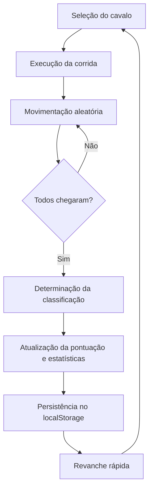

# HORSE DASH! 🏇

## Apresentação

O **HORSE DASH!** é um jogo arcade de corrida desenvolvido como projeto acadêmico com React, JavaScript, HTML e CSS, utilizando Vite como ferramenta de desenvolvimento.

A pessoa jogadora escolhe um entre três competidores — **Comet, Blaze e Pixel** — e acompanha uma corrida contra os demais cavalos. Cada competidor começa na mesma linha de largada e recebe variações aleatórias de velocidade dentro da mesma faixa.

> **Importante:** o jogo é exclusivamente recreativo. Não existem apostas, dinheiro real, prêmios financeiros ou compras.

## Objetivo do projeto

Praticar conceitos de desenvolvimento front-end, componentização com React, gerenciamento de estado, temporizadores, lógica de corrida, persistência de dados no navegador, acessibilidade e testes automatizados.

## Demonstração visual

Adicione nesta seção um GIF curto ou capturas de tela da tela inicial, da corrida em andamento e da classificação final. Os arquivos podem ser armazenados em uma pasta `docs/images/` e incorporados com Markdown, por exemplo:

```md

```

## Tecnologias utilizadas

- **React 19:** composição de componentes e atualização da interface.
- **JavaScript (ES Modules):** regras, estado e lógica da corrida.
- **HTML:** estrutura semântica da aplicação.
- **CSS:** identidade visual, animações, responsividade e foco acessível.
- **Vite:** servidor de desenvolvimento e build de produção.
- **Node.js Test Runner:** testes automatizados da lógica do jogo.
- **localStorage:** persistência local de pontuação, recorde e estatísticas.

## Funcionalidades

- Seleção entre Comet, Blaze e Pixel.
- Todos os cavalos começam com progresso zero.
- Corrida animada com velocidade aleatória dentro de uma faixa comum.
- Indicador visual e acessível de progresso de cada competidor.
- Classificação final com primeiro, segundo e terceiro lugares.
- Empates tratados sem atribuir pontos indevidos; competidores empatados compartilham a posição.
- Vitória do cavalo selecionado concede **100 pontos**.
- Recorde pessoal, pontuação acumulada, corridas disputadas e vitórias salvos no navegador.
- Revanche rápida sem atualizar a página.
- Tratamento de valores inválidos e falhas de armazenamento.
- Controles nativos acessíveis por teclado, estados anunciados por leitores de tela e respeito à preferência de redução de movimento.
- Layout responsivo para computador e dispositivos móveis.

## Regras da corrida e pontuação

1. A pessoa jogadora escolhe um cavalo antes da largada.
2. Os três competidores começam com progresso igual a zero.
3. A cada atualização, cada cavalo recebe um avanço aleatório dentro da mesma faixa de velocidade.
4. O instante estimado em que cada cavalo cruza a linha de chegada determina a ordem de chegada.
5. Empates na mesma atualização são mantidos na mesma posição; a posição seguinte considera a quantidade de competidores empatados.
6. Se o cavalo escolhido terminar isolado em primeiro lugar, a pontuação aumenta em 100 pontos.
7. Empates em primeiro lugar não concedem pontos.
8. Ao final, o jogo atualiza as estatísticas e permite iniciar outra corrida.

## Diagrama de funcionamento



## Executar localmente

1. Instale uma versão LTS do [Node.js](https://nodejs.org/).
2. Clone o repositório:
   ```bash
   git clone https://github.com/DogShown/HorseRacing.git
   cd HorseRacing
   ```
3. Instale as dependências:
   ```bash
   npm install
   ```
4. Execute os testes:
   ```bash
   npm test
   ```
5. Inicie o servidor:
   ```bash
   npm run dev
   ```
6. Abra no navegador o endereço local informado pelo Vite.

## Scripts disponíveis

| Comando | Descrição |
| --- | --- |
| `npm run dev` | Inicia o servidor de desenvolvimento. |
| `npm run build` | Gera os arquivos otimizados em `dist/`. |
| `npm run preview` | Executa uma prévia local da versão de produção. |
| `npm test` | Executa os testes automatizados da lógica da corrida. |

## Estrutura de pastas

```text
src/
├── data/
│   └── horses.js              # Dados e criação dos competidores
├── game/
│   ├── constants.js           # Regras e valores centralizados
│   ├── raceEngine.js          # Avanço, chegada e classificação
│   └── raceEngine.test.js     # Testes da lógica do jogo
├── hooks/
│   └── useRaceGame.js         # Estado, temporizadores e persistência
├── styles/
│   ├── tokens.css             # Cores, fontes e variáveis globais
│   ├── layout.css             # Estrutura e cabeçalho
│   ├── horses.css             # Cartões de seleção
│   ├── track.css              # Pista e indicadores de progresso
│   ├── panels.css             # Pontuação, estatísticas e resultados
│   ├── animations.css         # Animações
│   └── responsive.css         # Adaptação a diferentes telas
├── App.jsx                    # Componentes e composição da interface
├── App.css                    # Entrada dos estilos
└── main.jsx                   # Inicialização do React
```

## Qualidade e acessibilidade

- Navegação por teclado e foco visível nos controles.
- Nomes acessíveis e estados selecionados nos botões dos cavalos.
- Progresso anunciado por barras com atributos ARIA.
- Mensagens de resultado anunciadas por leitores de tela.
- Resultados identificados por texto e posição, não apenas por cor.
- Animações reduzidas quando o sistema solicita `prefers-reduced-motion`.
- Validação de dados persistidos e testes automatizados das regras centrais.

## Limitações conhecidas

- Pontuação, recorde e estatísticas ficam armazenados somente no navegador e dispositivo utilizados.
- Limpar os dados do navegador ou trocar de dispositivo pode apagar o progresso.
- Não há contas, ranking online, servidor, sincronização entre dispositivos ou modo multijogador.
- A demonstração visual deve ser adicionada ao README após a captura da interface em execução.

## Possíveis melhorias futuras

- Adicionar testes de interface e testes ponta a ponta em navegador.
- Incluir uma galeria de capturas de tela ou GIF atualizado.
- Permitir exportar e importar estatísticas locais.
- Aprimorar opções de acessibilidade e preferências de animação.

## Projeto acadêmico

Desenvolvido para fins educacionais e demonstração de conceitos de desenvolvimento front-end.
